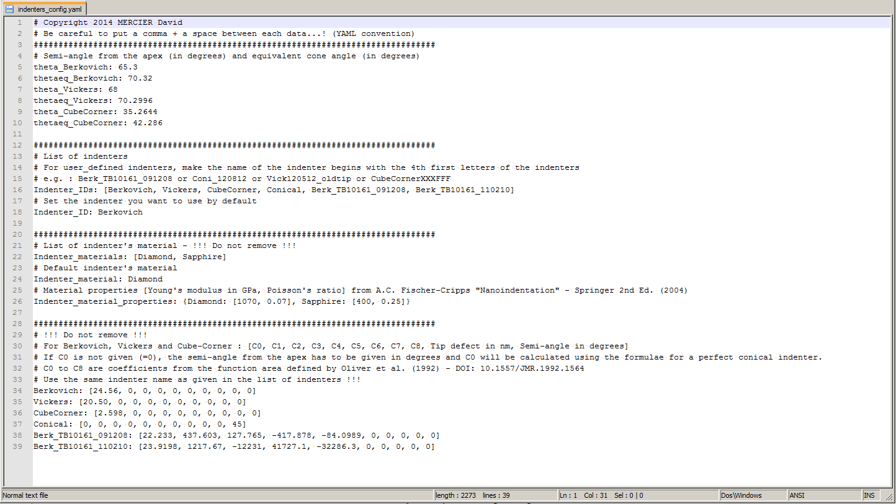

Configuration
==============

.. include:: includes.rst

What is a YAML file?
#########################

*"YAML is a human friendly data serialization standard for all programming languages."*

`Visit the YAML website for more information. <http://www.yaml.org/>`_

`Visit the YAML code for Matlab. <http://code.google.com/p/yamlmatlab/>`_

Update the YAML configuration files to use the Matlab toolbox correctly.

The YAML configuration files
#############################

The Matlab toolbox uses three YAML configuration files:
    
    - `indenters_config.yaml <https://github.com/DavidMercier/NIMS/blob/master/yaml_config_files/indenters_config.yaml>`_ provides the indenter properties (geometry and material).
    
    - `data_config.yaml <https://github.com/DavidMercier/NIMS/blob/master/yaml_config_files/data_config.yaml>`_ provides a path on your computer for easily selecting your data.
    
- `numerics_config.yaml <https://github.com/DavidMercier/NIMS/blob/master/yaml_config_files/numerics_config.yaml>`_ provides numerical parameters used by the toolbox.

How to modify YAML configuration files ?
##############################################

Please find the 3 YAML configuration files in the
`YAML folder <https://github.com/DavidMercier/nanoind-data-analysis/tree/master/yaml_config_files>`_.

   *Screenshot of the YAML configuration file used for indenter's properties.*

`indenters_config.yaml <https://github.com/DavidMercier/NIMS/blob/master/yaml_config_files/indenters_config.yaml>`_
can be used to change indenter properties:

* Enter your Indenter_ID(s) (e.g., Conical indenter, Berk_TB10161_091208, ...).
* Enter the indenter properties (e.g., Berk_TB10161_091208: [22.233, 437.603, 127.765, -417.878, -84.0989, 0]).

..  warning::
    * For user-defined indenters, begin the name with the first four letters of the indenter type (e.g., 'Berk_130214' for 'Berkovich').
    * Do not remove the standard indenters or materials.

`data_config.yaml <https://github.com/DavidMercier/NIMS/blob/master/yaml_config_files/data_config.yaml>`_
can be used to set the default absolute path for the folder where you store your indentation data.

`numerics_config.yaml <https://github.com/DavidMercier/NIMS/blob/master/yaml_config_files/numerics_config.yaml>`_
can be used to change the numerical parameters used by the toolbox from their standard values.

..  warning::
    * Separate each data item with a comma and a space (YAML convention).
    * Begin a line with # to add a comment.

The GUI's customized menu can also be used to edit and load the YAML configuration files.

.. note::
    To open and modify these YAML files, use Matlab or any code editor
    (e.g., `Notepad++ <https://notepad-plus-plus.org/>`_).