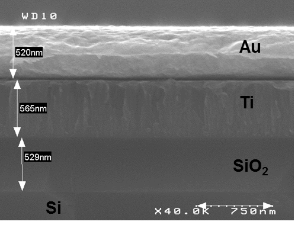

Examples of nanoindentation data
==================================

.. include:: includes.rst

See the experimental procedure proposed by Jennett N. M. and Bushby A. J. [#Jennett_2001]_
for performing nanoindentation tests on bulk materials, coatings, and multilayer systems, as well as the ISO 14577 (Parts 1-4) standard.

Data requirements
##################################

The NIMS toolbox accepts only Continuous Stiffness Measurement (CSM) data given as a function of indentation depth (e.g., CSM mode for Agilent-MTS nanoindenters or the DMA-CMX algorithm for Hysitron nanoindenters).

The toolbox analyzes the loading portion of the load-displacement curve.
For MTS Analyst spreadsheets with hold or unload segment markers,
it uses the rows before the first such marker. Otherwise, it retains samples through
the first maximum load and discards subsequent samples. All measurement and
standard-deviation columns are trimmed together.

The peak-load fallback assumes a single indentation cycle in acquisition
order. It cannot reliably identify noisy holds or distinguish multiple
loading cycles; inspect or prepare such data before importing. Loading-only
data should end at their maximum load. Extraction does not trim the source
file, although the existing text importer replaces commas with decimal points
in that file.

Select **Unloading load** on the Y axis to view the measured unloading load
against displacement. The plot uses the first explicitly marked unloading
segment, or the samples from the first peak onward when markers are absent.
The unmarked fallback may include a hold or later cycles; a loading-only file
has no unloading plot. This view shows raw measurements, without frame
compliance correction, depth filtering, or model fitting. Loading analysis
continues to use only the loading segment.

For one film on a substrate, select a reduced Young's modulus Y axis to
show the elastic model list. Use Ctrl-click (Command-click on macOS) to
select multiple models and compare their curves; each legend entry reports
the fitted film modulus. Each fit starts from the same input properties.
Residuals are available for a single model only. The Mencik linear model
does not use the optional thickness correction; this is noted in the legend.
Fits that do not converge are also identified in the legend.

Please check that surface detection is accurate, especially when the substrate is compliant [#Kaufman_2009]_ and [#Piccarolo_2010]_.
For more information about surface detection, see the `NIMS documentation <http://nims.readthedocs.org/en/latest/models.html>`_.

It is advisable to average results from at least 10 indentation tests to reduce artifacts
(e.g. pop-in, roughness, local impurities or dust on the sample's surface...).

.. note::
    To analyze pop-in distribution, the Matlab PopIn toolbox was developed. The `Matlab code <https://github.com/DavidMercier/PopIn>`_
    is available on GitHub with `the documentation <http://popin.readthedocs.org/en/latest/>`_.

Agilent - MTS example files
###############################

* Both .txt and .xls files are accepted.
* 3 columns (Displacement / Load / Stiffness)
* 6 columns (Disp. / SD (Disp.) / Load / SD (Load.) / Stiff. / SD (Stiff.)) (SD for Standard Deviation)
* These types of averaged sheets can be generated directly in your .xls file using the 'Analyst' Excel macro provided by MTS.

* `MTS_0film_Si_CSM-2nm_noSD.txt <https://github.com/DavidMercier/NIMS/blob/master/data_indentation/MTS_0film_Si_CSM-2nm_noSD.txt>`_
    - Data for a bulk Silicon sample.
    - Data obtained by Berkovich indentation with CSM mode (75Hz / amplitude 2nm) (no standard deviation).

* `MTS_1film_SiO2_Si_CSM-2nm.xls <https://github.com/DavidMercier/NIMS/blob/master/data_indentation/MTS_1film_SiO2_Si_CSM-2nm.xls>`_
    - Data for a thin film of Silicon thermal oxide (500nm) on a bulk Silicon sample.
    - Data obtained by Berkovich indentation with CSM mode (75Hz / amplitude 2nm).

* `MTS_1film_SiO2_Si_CSM-2nm_noSD.xls <https://github.com/DavidMercier/NIMS/blob/master/data_indentation/MTS_1film_SiO2_Si_CSM-2nm_noSD.xls>`_
    - Data for a thin film of Silicon thermal oxide (500nm) on a bulk Silicon sample.
    - Data obtained by Berkovich indentation with CSM mode (75Hz / amplitude 2nm) (no standard deviation).

* `MTS_2films_Al_SiO2_Si_CSM-2nm.xls <https://github.com/DavidMercier/NIMS/blob/master/data_indentation/MTS_2films_Al_SiO2_Si_CSM-2nm.xls>`_
    - Data for a thin film of PVD Aluminum (500nm) deposited on a bulk Silicon sample with a Silicon thermal oxide (500nm).
    - Data obtained by Berkovich indentation with CSM mode (75Hz / amplitude 2nm).

* `MTS_3films_Au-Ti-SiO2-Si_CSM-1nm.txt <https://github.com/DavidMercier/NIMS/blob/master/data_indentation/MTS_3films_Au-Ti-SiO2-Si_CSM-1nm.txt>`_
    - Data for a thin film of PVD Gold (500nm) deposited on thin film of PVD Titanium (500nm) on a bulk Silicon sample with a Silicon thermal oxide (500nm).
    - Data obtained by Berkovich indentation with CSM mode (75Hz / amplitude 1nm).

* `MTS_3films_Au-Ti-SiO2-Si_CSM-1nm.xls <https://github.com/DavidMercier/NIMS/blob/master/data_indentation/MTS_3films_Au-Ti-SiO2-Si_CSM-1nm.xls>`_
    - Data for a thin film of PVD Gold (500nm) deposited on thin film of PVD Titanium (500nm) on a bulk Silicon sample with a Silicon thermal oxide (500nm).
    - Data obtained by Berkovich indentation with CSM mode (75Hz / amplitude 1nm).

The last example (2 files for Au-Ti-SiO2-Si sample) is used to validate the elastic multilayer model of Mercier et al. [#Mercier_2010]_.
A micrograph of this sample is given :numref:`multilayer_sem`.

   
   *SEM cross-sectional observation of a multilayer sample.*
   
Hysitron example files
##########################

* Both .txt or .dat files are accepted.

* `Hysitron_dma.txt <https://github.com/DavidMercier/NIMS/blob/master/data_indentation/Hysitron_dma.txt>`_
    - Data obtained by Berkovich indentation with DMA mode (205Hz / amplitude 0.65nm) - Courtesy of `Dr. Igor Zlotnikov <https://www.researchgate.net/profile/Igor_Zlotnikov>`_ from `Max Planck Institute of Colloids and Interfaces <http://www.mpikg.mpg.de/>`_ in Potsdam, Germany.
    - Select Hysitron and import this file, then choose reduced storage modulus,
      reduced loss modulus, or loss tangent in the Y-axis menu. See
      :eq:`loss_modulus` for the input
      requirements and correction limitations.

References
############

.. [#Jennett_2001] `Jennett N. M. and Bushby A. J., "Adaptive Protocol for Robust Estimates of Coatings Properties by Nanoindentation" (2001). <https://doi.org/10.1557/PROC-695-L3.1.1>`_

.. [#Kaufman_2009] `Kaufman J. D. and Klapperich C. M., "Surface detection errors cause overestimation of the modulus in nanoindentation on soft materials" (2009). <https://doi.org/10.1016/j.jmbbm.2008.08.004>`_

.. [#Mercier_2010] `Mercier D. et al., "Young's modulus measurement of a thin film from experimental nanoindentation performed on multilayer systems" (2010). <https://doi.org/10.1051/mattech/2011029>`_

.. [#Piccarolo_2010] `Piccarolo S. et al., "Improving surface detection on nanoindentation of compliant materials" (2010). <https://doi.org/10.1088/0957-0233/21/6/065701>`_

- `ISO 14577 - 1 , "Metallic materials -- Instrumented indentation test for hardness and materials parameters -- Part 1: Test method", (2002). <http://www.iso.org/iso/home/store/catalogue_tc/catalogue_detail.htm?csnumber=30104>`_

- `ISO 14577 - 2 , "Metallic materials -- Instrumented indentation test for hardness and materials parameters -- Part 2: Verification and calibration of testing machines", (2002). <http://www.iso.org/iso/home/store/catalogue_tc/catalogue_detail.htm?csnumber=30543>`_

- `ISO 14577 - 3 , "Metallic materials -- Instrumented indentation test for hardness and materials parameters -- Part 3: Calibration of reference blocks", (2002). <http://www.iso.org/iso/home/store/catalogue_tc/catalogue_detail.htm?csnumber=32193>`_

- `ISO 14577 - 4 , "Metallic materials -- Instrumented indentation test for hardness and materials parameters -- Part 4: Test method for metallic and non-metallic coatings", (2007). <http://www.iso.org/iso/home/store/catalogue_tc/catalogue_detail.htm?csnumber=39228>`_

- `Agilent website <http://www.agilent.com/>`_

- `Hysitron website <https://www.hysitron.com/>`_
