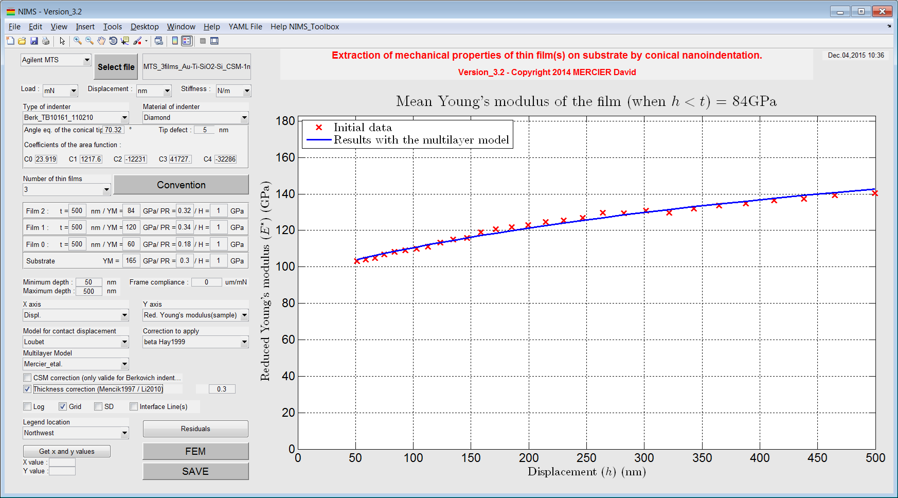

.. Matlab documentation master file, created by
   sphinx-quickstart on Fri Apr 04 20:28:37 2014.
   You can adapt this file completely to your liking, but it should at least
   contain the root `toctree` directive.
   
.. include:: includes.rst
   
NIMS |matlab| toolbox
=======================

The NIMS toolbox has been developed to plot and analyze (nano)indentation
data obtained with conical indenters for bulk materials and multilayer samples.

With this Matlab toolbox, it is possible to:

* plot and correct nanoindentation datasets with standard deviations;
* calculate the coefficient of the power-law fit to the load-displacement curve;
* calculate the loading energy (the area under the load-displacement curve);
* plot the evolution of stiffness and load/stiffness squared;
* calculate the Young's modulus and hardness of bulk materials;
* calculate the Young's modulus and hardness of thin films on a substrate, for bilayer or multilayer samples (up to three layers on a substrate).

Finite element modelling
------------------------

NIMS provides separate workflows for indentation modelling:

* **Abaqus via MATLAB:** generate an axisymmetric bulk or multilayer model with a
  cono-spherical indenter from the MATLAB GUI.
* **Abaqus via Abapy:** prepare a bulk or multilayer axisymmetric Abaqus input-deck
  script from MATLAB, Python or the multilayer notebook. This linear-elastic
  model uses a sharp cone; executing the generated script requires a separate
  compatible Abapy environment. Abapy is an input generator, not a solver.
* **Ansys Discovery and Mechanical:** create a parameterized 3D specimen with
  one to three coatings and a cono-spherical indenter, and prepare a
  Mechanical indentation analysis. The supplied material data are
  illustrative and require replacement before interpreting results.

These workflows prepare models or input files; they do not automatically
solve the analysis. See :doc:`python_abaqus` for setup instructions,
prerequisites and limitations.

`Source code is hosted on GitHub <https://github.com/DavidMercier/NIMS>`_.

   
`Download the source code as a ZIP file <https://github.com/DavidMercier/NIMS/archive/master.zip>`_.

   
`Download the documentation as a PDF file <https://media.readthedocs.org/pdf/nims/latest/nims.pdf>`_.
   

   
   *Screenshot of the main window of the NIMS toolbox.*

Contents
==========
   
.. toctree::
   :maxdepth: 3
   
   getting_started
   configuration
   models
   models_thin_films
   minimization
   examples
   python_abaqus
   machine_learning_indentation
   links_ref
   
Contact
=========
:Author: `David Mercier <david9684@gmail.com>`_ [1,2,3]

[1] `CEA, 17 Avenue des Martyrs, 38000 Grenoble, France <http://www.cea.fr/Pages/le-cea/les-centres-cea/grenoble.aspx>`_

[2] `Max-Planck-Institut für Eisenforschung, 40237 Düsseldorf, Germany <http://www.mpie.de/>`_

[3] `CRM Group, Avenue du Bois Saint-Jean 21, B27 – Quartier Polytech 4, 4000 Liège, Belgium <http://www.crmgroup.be/>`_

Acknowledgements
==================

The author is grateful to `Dr. V. Mandrillon <https://www.researchgate.net/profile/Vincent_Mandrillon>`_ from (`CEA <http://www.cea.fr/le-cea/les-centres-cea/grenoble>`_, France (Grenoble))
and Dr. M. Verdier from (`SIMaP <http://simap.grenoble-inp.fr>`_, France (Grenoble)) for many fruitful discussions about nanoindentation.

The author is grateful to `Dr. Igor Zlotnikov <https://www.researchgate.net/profile/Igor_Zlotnikov>`_ 
(`Max Planck Institute of Colloids and Interfaces <http://www.mpikg.mpg.de/>`_, Germany (Potsdam)), for providing example files.

Keywords
========

|matlab| toolbox ; nanoindentation ; conical indenter ; Young's modulus ; hardness ; 
thin film ; multilayer system ; analytical model ; python script ; finite element modelling.
