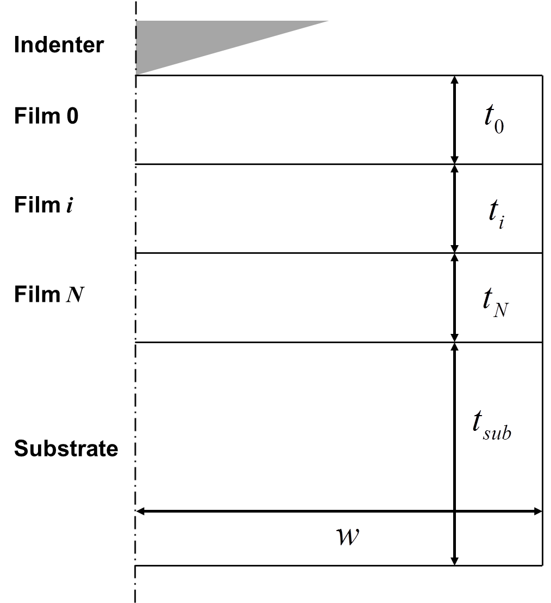
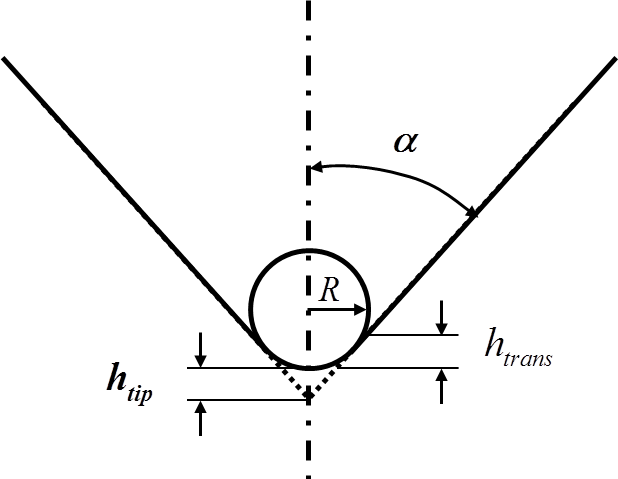
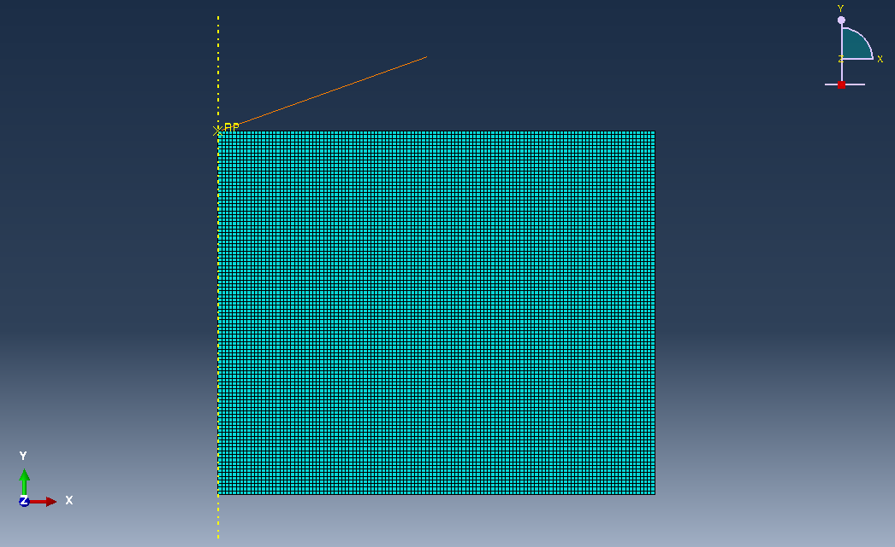
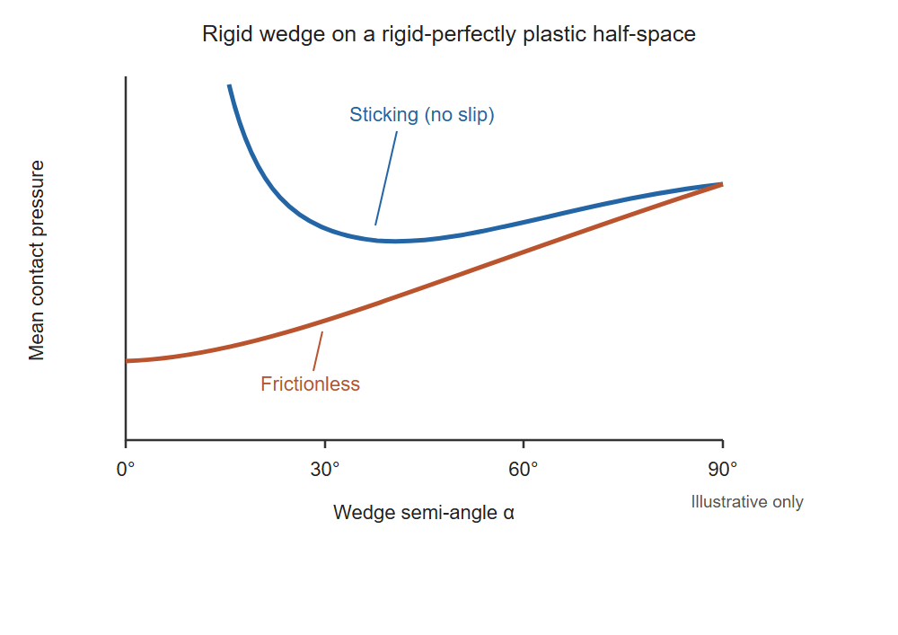
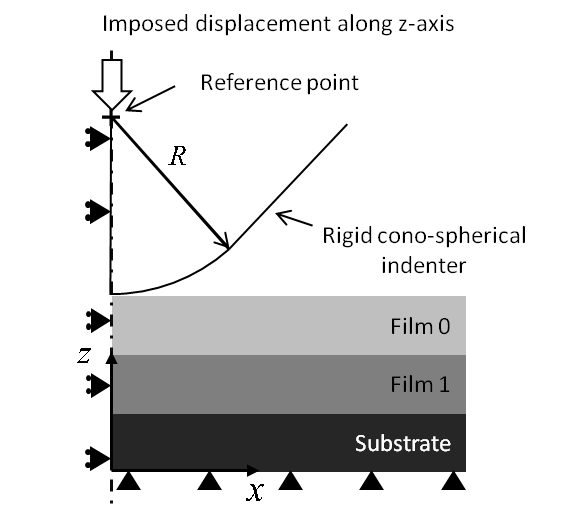
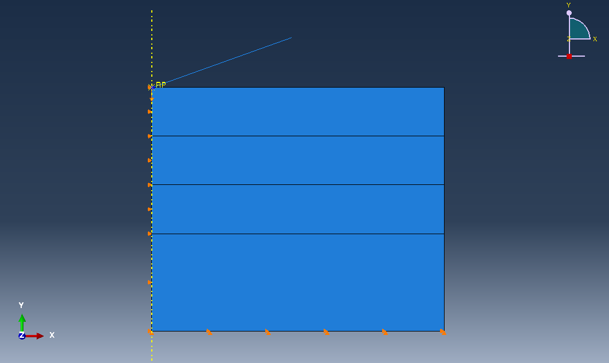
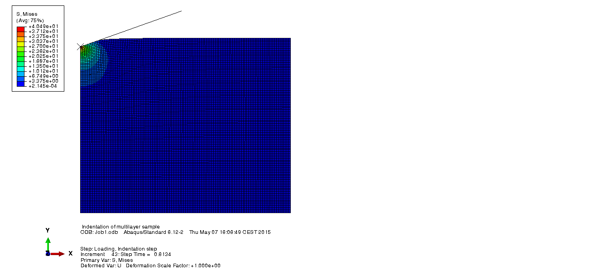
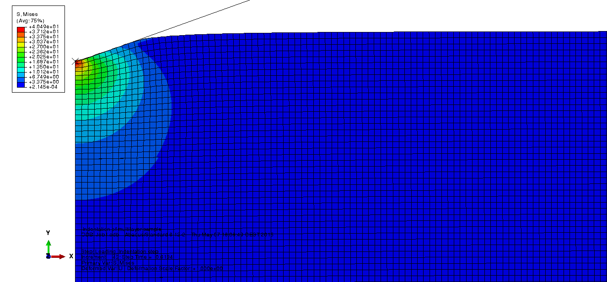
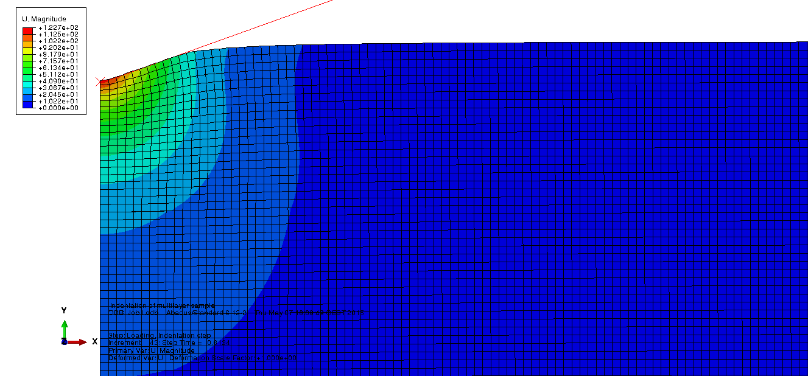

Indentation FEM workflows
=========================

.. include:: includes.rst

Two workflows prepare models for the **Abaqus** solver: the MATLAB-generated
CAE script and the separate Abapy input-deck bridge. A third workflow prepares
a model for **Ansys Mechanical** using Discovery/SpaceClaim and Workbench.
Abapy is a Python library for generating Abaqus input, not a solver.
The workflows have different geometries, materials and setup assumptions;
the model details in each section apply only to that workflow. None submits
or solves an analysis automatically.

Abaqus: MATLAB-generated model
##################################

This workflow generates a model of conical nanoindentation for Abaqus/CAE.

The |matlab| function used to generate a Python script for ABAQUS is :
`python_abaqus <https://github.com/DavidMercier/NIMS/blob/master/matlab_code/fem/python4abaqus.m>`_

The model is axisymmetric, with a geometry-dependent mesh
and restricted boundary conditions.

Geometry of the (multilayer) sample
-------------------------------------

Each layer of the sample is characterized by its thickness (:math:`t_\text{i}`).

The thickness of the substrate (:math:`t_\text{sub}`) is set as
2 times the highest thin film thickness.

The width (:math:`w`) of the sample is calculated as a function of
the substrate thickness or the indenter tip defect.

No delamination is allowed between thin films or between thin film and substrate.

..  note::
    Dimensions are in nm.
    

   
   *Geometry of the sample in the FEM model.*

Geometry of the indenter
---------------------------------

The indenter is defined as a rigid cono-spherical indenter.
A spherical part is defined at the apex of the conical indenter, as shown below.

   
   *Scheme of a cono-spherical indenter.*

The radius :math:`R` of the spherical part is calculated from the tip defect :math:`h_\text{tip}`
and the cone angle :math:`\alpha`, using the following equation. For Berkovich, Vickers, and cube-corner
indenters, the equivalent cone angle is used to set the cone angle.

       .. math:: R = \frac{h_\text{tip}}{\frac{1}{sin(\alpha)} - 1}
          :label: tip_radius_fem

In the case of a perfect conical indenter (:math:`h_\text{tip} = 0\text{nm}`), a tip defect of 1 nm, corresponding to a radius of :math:`R = 1.6\text{nm}`, is set in the Python file. Defining a cono-spherical tip avoids the geometrical singularity at the apex of the
perfect conical indenter, which would imply an infinite stress at the contact interface. But, any non-zero positive value for the tip radius can be set into the GUI. 

The transition depth :math:`h_\text{trans}` between the spherical and conical parts of a cono-spherical indenter
is calculated from the following equation:

       .. math:: h_\text{trans} = R(1-sin(\alpha))
          :label: transition_depth_fem
			
See the |matlab| function for calculating the tip radius:
`tipRadius.m <https://github.com/DavidMercier/NIMS/blob/master/matlab_code/fem/tipRadius.m>`_.

See the |matlab| function for calculating the transition depth:
`transitionDepth.m <https://github.com/DavidMercier/NIMS/blob/master/matlab_code/function_area/transitionDepth.m>`_.

See the |matlab| function for calculating the tip defect:
`tipDefect.m <https://github.com/DavidMercier/NIMS/blob/master/matlab_code/function_area/tipDefect.m>`_.

Mesh
---------------------------------

The multilayer sample is divided by default into solid elements with eight nodes
and axisymmetric deformation element CAX8R is adopted.

It is possible to divide the sample into solid elements with four nodes
and with axisymmetric deformation element CAX4R, by changing the value of the
variable "linear_elements" in the |matlab| function
`python4abaqus <https://github.com/DavidMercier/NIMS/blob/master/matlab_code/fem/python4abaqus.m>`_
from 0 (quadratic elements) to 1 (linear elements).

..  note::
    * CAX4R: A 4-node bilinear axisymmetric quadrilateral, reduced integration, hourglass control.
    * CAX3:  A 3-node linear axisymmetric triangle.
    * CAX8R: An 8-node biquadratic axisymmetric quadrilateral, reduced integration.
    * CAX6M: A 6-node modified quadratic axisymmetric triangle.
    

   
   *Screenshot in Abaqus of the mesh example used in the FE model.*

Material properties
---------------------------------

For each layer of the multilayer sample, the material properties
(Young's modulus and Poisson's ratio) are defined using the inputs
given by the user from the GUI. Material properties are considered
by default to be isotropic. The density is set by default to 1.0.

..  note::
    Young's moduli are in GPa.

Contact definition
----------------------

By default, the contact is defined as frictionless in the tangential
behavior and hard for the normal behavior.

The external surface of the indenter is defined as the "master"
region and the top surface of the (multilayer) sample is defined as the "slave" region.

Influence of friction
---------------------

Friction opposes relative tangential motion between the indenter and the
sample and can change the deformation field, contact area and indentation
load. In the Coulomb model, the tangential traction magnitude :math:`|q|`
is bounded by :math:`\mu p`, where :math:`p` is the local normal contact
pressure and :math:`\mu` is the dimensionless coefficient of friction:

.. math:: |q| \leq \mu p

Equality applies during sliding; the ratio :math:`|q|/p` can be smaller
than :math:`\mu` in a sticking region. A frictionless contact has
:math:`\mu = 0`. The effective coefficient depends on the contacting
materials and surface conditions; the effect of friction on indentation
also depends on the contact geometry and material response.

Johnson's idealized analysis considers a rigid wedge indenting a
rigid-perfectly plastic half-space [#Johnson_1987]_. The mean pressure depends
on the wedge semi-angle :math:`\alpha` and on the frictional constraint.
As illustrated in :numref:`friction_wedge_schematic`, the difference between
frictionless and sticking conditions generally decreases as the wedge becomes
blunter, especially above approximately :math:`50^\circ`. This is a
qualitative trend, not a universal threshold for neglecting friction.

   *Qualitative schematic inspired by Johnson's rigid-wedge indentation
   analysis* [#Johnson_1987]_. *The curves are illustrative, not numerical
   predictions; no thesis-specific region is excluded.*

The wedge result is not directly quantitative for a conical or spherical
indenter, an elastic-plastic solid, or a layered sample. In particular, the
local contact geometry of a rounded tip changes with penetration. The
frictionless assumption in the NIMS FEM generator is therefore a
simplification, not a guarantee of negligible friction. For friction-sensitive
materials, sharp tips or interfaces, assess its influence with a sensitivity
study using suitable friction coefficients and compare the resulting loads,
contact areas and deformation fields [#DiCarlo_2004]_, [#Harsono_2008]_,
[#Wang_2016]_.

Boundary conditions
------------------------

Nodes are constrained along the rotation axis from moving in the radial direction (:math:`x`).
The nodes on the bottom surface of the sample are constrained along the radial axis
from moving in the radial (:math:`x`) and vertical (:math:`z`) directions (see :numref:`fem_model_bc` and :numref:`fem_model_parts_bc`).

Indentation process is simulated by imposing a vertical displacement
to the rigid indenter along the (:math:`z`) axis (see :numref:`fem_model_bc` and :numref:`fem_model_parts_bc`).
A value of 200nm for the indentation depth is set by default.

   
   *Schematic of the boundary conditions used in the FE model.*
    

   
   *Screenshot of the FE model with BCs in Abaqus.*
   
..  warning::
    Indentation displacement is given in nanometers and is negative.

Generating and running the Abaqus model script
----------------------------------------------

After configuring the material properties (Young's moduli and Poisson's ratios)
and specifying the model geometry (the thickness of each thin film),
generate a Python script for ABAQUS by pressing the 'FEM' button.

The Python script is saved in the folder containing your nanoindentation results.

To generate the FEM model in ABAQUS, apply the following procedure:

- start ABAQUS
- Select the folder containing the input files: 'File' ==> 'Set Work Directory...'
- Select and run the Python file containing the FEM model (\*.py): 'File' ==> 'Run Script'

..  note::
    Dimensions are in nm and Young's moduli are in GPa, implying that load is in nN.
    Running the script creates the model; the analysis must be submitted separately.

Example Abaqus results
----------------------

The following pictures were obtained for a `multilayer Au/Ti/SiO2/Si <https://github.com/DavidMercier/NIMS/blob/master/data_indentation/MTS_3films_Au-Ti-SiO2-Si_CSM-1nm.xls>`_.

   *Screenshot of the Von Mises stress distribution at maximum load.*

   *Screenshot (with a zoom in on the contact area) of the Von Mises stress distribution at maximum load.*

   *Screenshot (with a zoom in on the contact area) of the magnitude of the displacement at maximum load.*

Abaqus: Abapy axisymmetric input-deck export
#############################################

The separate `Abapy <https://abapy.readthedocs.io/en/latest/>`_ bridge creates
an Abaqus input deck for a bulk or multilayer isotropic linear-elastic sample.
It does not extract plastic hardness or replace the existing MATLAB/CAE FEM
generator above. It uses CAX4 elements and a sharp Abapy meshed cone constrained
as rigid, with frictionless contact and loading/unloading steps. This is not
the rounded cone used by the existing NIMS generator.

Abapy's published code uses Python 2 syntax and requires a separately
configured compatible Python environment and its dependencies. It is not
included in NIMS and is not known to work in a current Python 3 notebook
kernel. Provide the full path to that environment's Python executable.
From MATLAB, after adding the NIMS folders to the path, run for example::

    abapy_export('C:\path\to\python.exe', 'C:\work\bulk.inp', 165, 0.28, 200, 600, 70.3)

The arguments are executable, new output file, Young's modulus (GPa), Poisson
ratio, maximum depth (nm), fine mesh region size (nm), and cone half-angle
(degrees, optional; default 70.3). The mesh region size must exceed the
depth; it is not the full specimen size. Existing files are never overwritten.
Choose domain size, mesh density and loading conditions based on convergence
studies. The optional cell in the multilayer notebook calls the same bridge
using its substrate properties and the fitted top-film modulus.

Preparing a multilayer script without installing Abapy
------------------------------------------------------

Python 3 can prepare a self-contained script without importing Abapy.
Run the following from the repository root (one command, shown split for
readability)::

    python matlab_code\fem\abapy_export.py --prepare-script
        --output multilayer_abapy.py --young 165 --poisson 0.28
        --depth 200 --mesh-size 600 --width 6000 --substrate-depth 6000
        --film 500 90 0.32 --film 500 120 0.34 --film 500 70 0.18

Each ``--film`` specifies thickness (nm), Young's modulus (GPa), and Poisson
ratio, ordered **surface to substrate** (Au, Ti, SiO2 in this example).
The 90 GPa value is illustrative; the notebook uses its actual fitted value.
``--young`` and ``--poisson`` specify the substrate, and ``--substrate-depth``
and ``--width`` specify its thickness and the full sample radial extent.
With films, ``--mesh-size`` controls only the indenter mesher length scale.

The sample mesh has rows exactly at each interface and shared nodes across
regions, enforcing perfect bonding without duplicate nodes or tie contacts.
Each film and the substrate have their own element set and material section.
This is a rectangular finite domain; the axis is constrained radially and the
bottom is fixed. The outside radial edge is free. Defaults are 64 radial
elements, 16 rows per film, and 32 substrate rows; adjust
``--radial-elements``, ``--layer-elements``, and ``--substrate-elements`` for
mesh convergence. Abapy's single-material ``MakeInp`` is retained for bulk
only; the multilayer path assembles sections using Abapy's mesh, material,
indenter and step exporters.

From MATLAB, the same preparation can be invoked using a regular Python 3::

    films = [500 90 0.32; 500 120 0.34; 500 70 0.18];
    abapy_export('C:\path\to\python.exe', 'C:\work\multilayer_abapy.py', ...
        165, 0.28, 200, 600, 70.3, films, 6000, 6000, true)

Alternatively set ``prepare_abapy_script = True`` in the notebook. Run the
resulting script later with a compatible Abapy interpreter, in the desired
working directory. It writes ``multilayer_abapy.inp`` there, refuses to
overwrite it, and submits no job. For direct export with Abapy installed,
omit ``--prepare-script`` and use a new ``.inp`` output filename.

The bridge only generates an input file. Review its mesh, contact, boundary
conditions and outputs in a compatible Abaqus installation before use; no
Abaqus job is submitted. Local tests check mesh topology, layer assignments,
and script preparation; they do not validate the external Abapy exporters.
Neither the MATLAB wrapper nor an Abaqus solution has been executed locally.

Ansys: Discovery geometry and Mechanical indentation
####################################################

The separate Ansys workflow creates a three-dimensional cylindrical silicon
substrate, one to three coatings, and a rigid cono-spherical indenter. It does
not use the NIMS GUI or replace the Abaqus generator. The geometry is created
with the active Discovery/SpaceClaim scripting API (tested with V242 and
V261 in SpaceClaim); the indentation analysis is prepared in Workbench and
Mechanical.

1. In a new, empty Discovery document, set the length scale to **Small**
   and the displayed length unit to micrometres. Edit and run
   `discovery_indentation_geometry.py <https://github.com/DavidMercier/NIMS/blob/master/matlab_code/fem/discovery_indentation_geometry.py>`_
   in the script editor. When pasting into a new script, keep the editor's
   API version header and include the final ``create_geometry()`` call.
   The script fits an isometric view of all bodies; use an English-language
   interface for the named view. It does not reset or save the document.
   Save the resulting geometry and use its actual absolute path below.
2. Edit the three absolute paths at the top of
   `workbench_indentation.wbjn <https://github.com/DavidMercier/NIMS/blob/master/matlab_code/fem/workbench_indentation.wbjn>`_:
   the saved geometry, the
   `mechanical_indentation_setup.py <https://github.com/DavidMercier/NIMS/blob/master/matlab_code/fem/mechanical_indentation_setup.py>`_
   script and a new ``.wbpj`` project path. In a new Workbench project, run
   the journal using **File > Scripting > Run Script File**. It refuses to
   overwrite an existing project or its associated files.
3. Open the saved model in Mechanical, review the geometry, material data,
   contact, mesh and analysis settings, then generate the mesh and solve.
   The journal prepares the analysis but does not mesh or solve it.

Geometry parameters are edited at the top of the Discovery script, in
micrometres. The ``layers`` list contains one to three ``(material, thickness)``
pairs, ordered from the exposed surface down to the substrate. The supplied
coating names are ``SiO2``, ``Al`` and ``Al2O3``. For another coating, use a
name containing only letters, digits and underscores and add a matching
material entry to the Workbench journal. By default their
thicknesses are 0.1, 0.2 and 0.3 µm, respectively; the substrate radius is
18.5 µm, its thickness is 37 µm, and the indenter has a 7.4 µm tip radius
and a 70.3-degree cone half-angle. The spherical and conical profiles are
tangent. The sample surface and indenter apex initially touch at :math:`z=0`.
Do not share topology between the separate bodies.

The Mechanical setup assigns an isotropic elastic silicon substrate, an
elastic-plastic coating model and a rigid indenter. Separate coating
interfaces are bonded and the indenter contact is frictionless. The bottom
of the substrate is fixed; a remote displacement loads the indenter to
0.2 µm and unloads it over two analysis steps. A reaction-force probe is
provided at maximum depth. The depth and initial mesh sizes can be changed
in the Mechanical script.

.. warning::
   All supplied elastic constants and plastic stress-strain curves are
   **illustrative, not validated material data**. In particular, isotropic
   plasticity is not necessarily an appropriate constitutive model for
   silicon dioxide or alumina. Replace the properties with suitable measured
   data and models before interpreting results.

The body-wide coating sizing can produce a very large 3D mesh, especially
for thin films. Select an appropriate local mesh strategy and check mesh and
domain-size convergence, contact settings, loading increments, units and
solver warnings. The geometry and material parameters are independent of
the Abaqus settings. Small-unit models are not solved in Discovery's
Explore/Refine stages; use the Mechanical workflow instead.

Future developments
###############################

Thin-film material properties have also been evaluated using FEM analysis
coupled with machine learning [#Han_2022]_. See
:doc:`machine_learning_indentation` for a literature overview.
    
References
############

.. [#AtkinsTabor_1965] `Atkins A.G. and Tabor D., "Plastic indentation in metals with cones" (1965). <https://doi.org/10.1016/0022-5096(65)90018-9>`_
.. [#DiCarlo_2004] `DiCarlo A. et al., "Prediction of stress–strain relation using cone indentation: effect of friction" (2004). <https://doi.org/10.1002/nme.979>`_
.. [#Harsono_2008] `Harsono E. et al., "The effect of friction on indentation test results" (2008). <https://doi.org/10.1088/0965-0393/16/6/065001>`_
.. [#Johnson_1987] `Johnson K.L., "Contact Mechanics" (1987), ISBN - 9780521347969. <https://www.cambridge.org/core/books/contact-mechanics/E3707F77C2EBCE727C3911AFBD2E4AC2>`_
.. [#Wang_2016] `Wang. Y., "Effects of indenter angle and friction on the mechanical properties of film materials" (2016). <https://doi.org/10.1016/j.rinp.2016.08.008>`_
.. [#Han_2022] `Han G., "Evaluation of thin film material properties using a deep nanoindentation and ANN" (2022). <https://doi.org/10.1016/j.matdes.2022.111000>`_

Other links / References
########################

* ABAQUS documentation
* `Charleux L., "Abapy Documentation" <http://abapy.readthedocs.org/en/latest/index.html>`_

* `Bhattacharya A.K. and Nix W.D., "Analysis of elastic and plastic deformation associated with indentation testing of thin films on substrates" (1988). <https://doi.org/10.1016/0020-7683(88)90091-1>`_
* `Bhattacharya A.K. and Nix W.D., "Finite element analysis of cone indentation." (1991). <https://doi.org/10.1016/0020-7683(91)90100-T>`_
* `Madsen D.T. et al. "Finite Element Simulation of Indentation Behavior of thin Films." (1991). <https://doi.org/10.1557/PROC-239-431>`_
* `Sun Y. et al., "Finite element analysis of the critical ratio of coating thickness to indentation depth for coating property measurements by nanoindentation." (1995). <https://doi.org/10.1016/0040-6090(94)06357-5>`_
* `Bolshakov A. and Pharr G.M., "Influences of pile-up on the measurement of mechanical properties by load and depth sensing indentation techniques." (1998) <https://doi.org/10.1557/JMR.1998.0146>`_
* `Lichinchi M. et al., "Simulation of Berkovich nanoindentation experiments on thin films using finite element method." (1998). <https://doi.org/10.1016/S0040-6090(97)00739-6>`_
* `Chen X. and Vlassak J.J., "A Finite Element Study on the Nanoindentation of Thin Films." (2000). <https://doi.org/10.1557/PROC-649-Q1.3>`_
* `Chen X. and Vlassak J.J., "Numerical study on the measurement of thin film mechanical properties by means of nanoindentation." (2001). <https://doi.org/10.1557/JMR.2001.0408>`_
* `Bouzakis K.-D. et al., "Thin hard coatings stress–strain curve determination through a FEM supported evaluation of nanoindentation test results.", (2001). <https://doi.org/10.1016/S0257-8972(01)01275-0>`_
* `Hubert N. et al. "Identification of elastic-plastic material parameters from pyramidal indentation of thin films." (2002). <https://doi.org/10.1098/rspa.2001.0927>`_
* `Shan Z. and Sitaraman S.K., "Elastic–plastic characterization of thin films using nanoindentation technique." (2003). <https://doi.org/10.1016/S0040-6090(03)00663-1>`_
* `He J.L. and Veprek S., "Finite element modeling of indentation into superhard coatings." (2003). <https://doi.org/10.1016/S0257-8972(02)00628-X>`_
* `Xu Z.-H. and Rowcliffe D., "Finite element analysis of substrate effects on indentation behaviour of thin films." (2004). <https://doi.org/10.1016/S0040-6090(03)01071-X>`_
* `Gamonpilas C. and Busso E.P., "On the effect of substrate properties on the indentation behaviour of coated systems." (2004). <https://doi.org/10.1016/j.msea.2004.04.038>`_
* `Panich N. and Sun Y. "Effect of penetration depth on indentation response of soft coatings on hard substrates: a finite element analysis" (2004) <https://doi.org/10.1016/j.surfcoat.2003.07.002>`_
* `Cai X. and Bangert H., "Hardness measurements of thin films-determining the critical ratio of depth to thickness using FEM." (2005). <https://doi.org/10.1016/0040-6090(95)06569-5>`_
* `Bressan J.D. et al., "Modeling of nanoindentation of bulk and thin film by finite element method." (2005). <https://doi.org/10.1016/j.wear.2004.05.021>`_
* `Pelletier H. et al., "Characterization of mechanical properties of thin films using nanoindentation test." (2006) <https://doi.org/10.1016/j.mechmat.2006.02.011>`_
* Charleux L., "Micromécanique de l'essai d'indentation : expériences et simulations.", PhD thesis, Institut National Polytechnique de Grenoble (2006).
* `Xu H., "A Finite Element Study of the Contact Stiffness of Homogenous Materials and Thin Films." PhD thesis - University of Tennessee - Knoxville (2007) <http://etd.utk.edu/2007/XuHaitao.pdf>`_
* `Antunes J.M. et al., "On the determination of the Young's modulus of thin films using indentation tests" (2007). <https://doi.org/10.1016/j.ijsolstr.2007.06.015>`_
* `Chen S.H. et al., "Small scale, grain size and substrate effects in nano-indentation experiment of film–substrate systems." (2007). <https://doi.org/10.1016/j.ijsolstr.2006.11.033>`_
* `Huang X. and Pelegri A.A., "Finite element analysis on nanoindentation with friction contact at the film/substrate interface." (2007). <https://doi.org/10.1016/j.compscitech.2006.10.005>`_
* Kopernik M. and Pietrzyk M., "2d numerical simulation of elasto-plastic deformation of thin hard coating systems in deep nanoindentation test with sharp indenter." (2007).
* `Pelegri A.A. and Huang X., "Nanoindentation on soft film/hard substrate and hard film/soft substrate material systems with finite element analysis." (2008). <https://doi.org/10.1016/j.compscitech.2007.05.033>`_
* `Wittler O. et al., "Mechanical characterisation of thin metal layers by modelling of the nanoindentation experiment." (2008). <https://doi.org/10.1109/ESTC.2008.4684488>`_
* `Sakharova N.A. et al., "Comparison between Berkovich, Vickers and conical indentation tests: A three-dimensional numerical simulation study." (2009). <https://doi.org/10.1016/j.ijsolstr.2008.10.032>`_
* `Rao C.S. and Reddy C.E., "Finite element modeling of nanoindentation to extract load-displacement characteristics of bulk materials and thin films." (2009). <http://nopr.niscair.res.in/handle/123456789/3133>`_
* `Gonzalez M. et al., "Modeling the substrate effects on nanoindentation mechanical property measurement." (2009). <https://doi.org/10.1109/ESIME.2009.4938456>`_
* `Chen C., "2-D Finite Element Modeling for Nanoindentation and Fracture Stress Analysis.", PhD thesis - University of South Florida (2009). <http://scholarcommons.usf.edu/etd/1897/>`_
* `Moore S.W. et al., "Nanoindentation in elastoplastic materials: insights from numerical simulations." (2010). <https://doi.org/10.1080/19475411003589889>`_
* Guo W., "On the influence of indenter tip geometry on the identification of material parameters in indentation testing.", PhD thesis, University of Liège (2010).
* `Wang J.S. et al., "Identification of elastic parameters of transversely isotropic thin films by combining nanoindentation and FEM analysis." (2010). <https://doi.org/10.1016/j.commatsci.2010.05.025>`_
* `Jiang L.M. et al., "Elastic-plastic properties of thin film on elastic-plastic substrates characterized by nanoindentation test." (2010). <https://doi.org/10.1016/S1003-6326(10)60653-X>`_
* `Miller D.C. et al., "Thermo-mechanical properties of alumina films created using the atomic layer deposition technique." (2010). <https://doi.org/10.1016/j.sna.2010.09.018>`_
* `Dowhan L. et al., "Investigation of thin films by nanoindentation with doe and numerical methods." (2011). <http://doi.org/10.1109/ESIME.2011.5765768>`_
* `Isselé H. et al., "Determination of the Young's modulus of a TiN Thin Film by nanoindentation: analytical models and numerical FEM simulation." (2012). <http://doi.org/10.1380/ejssnt.2012.624>`_
* `Phiciato's blog (2013) <https://phiciato.wordpress.com/2013/07/11/abaqus-simple-case-indentation-of-thin-coating/>`_
* `Karimpour M. et al., "An inverse method for extracting the mechanical properties of the constituent materials of a multilayer from nanoindentation data." (2013). <http://doi.org/10.1016/j.commatsci.2012.11.007>`_
* `Lee J.-H., Ham J.-B. and Kim Y.-C., "An Investigation of the Indentation Elastic Modulus for Metal Films on Flexible Substrates Considering the Substrate Effect." (2025). <https://doi.org/10.3390/ma18010154>`_
* `Zak S., Trost C. O. W., Kreiml P. and Cordill M. J., "Accurate measurement of thin film mechanical properties using nanoindentation." (2022). <https://doi.org/10.1557/s43578-022-00541-1>`_
* Fourcade T., "Études des propriétés mécaniques de matériaux métalliques en couches minces", PhD thesis - Université de Toulouse (2013).
* `Moćko W. et al., "Simulation of nanoindentation experiments of single-layer and double-layer thin films using finite element method." (2014). <http://doi.org/10.1002/sia.5473>`_
* `Kibech S. et al., "Nanoindentation" (2014). <https://nanohub.org/resources/nanoindentation>`_
* `Kopernik M. and Milenin A., "Numerical modeling of substrate effect on determination of elastic and plastic properties of TiN nanocoating in nanoindentation test." (2014). <http://doi.org/10.1016/j.acme.2013.10.001>`_
* `Li Y. et al., "Models for nanoindentation of compliant films on stiff substrates" (2015). <https://doi.org/10.1557/jmr.2015.126>`_
* `Moreau S. et al., "Application of Design of Computer Experiments (DoCE) method for the extraction of the elasto-plastic behavior law of ECD copper through nano-indentation tests" (2015). <https://doi.org/10.1109/EuroSimE.2015.7103084>`_
* `Gupta A. K. et al., "Evaluation of elasto-plastic properties of ITO film using combined nanoindentation and finite element approach" (2015). <https://doi.org/10.1016/j.ceramint.2015.09.054>`_
* `Veprek-Heijman M.G.J. and Veprek S., "The deformation of the substrate during indentation into superhard coatings: Bückle's rule revised" (2016). <https://doi.org/10.1016/j.surfcoat.2015.10.064>`_
* `Du Y. et al., "A novel tri-layer nanoindentation method to measure the mechanical properties of a porous brittle ultra-low-k dielectric thin film" (2017). <https://doi.org/10.1016/j.eml.2017.02.005>`_
* `Lofaj F. and Németh D., "The effects of tip sharpness and coating thickness on nanoindentation measurements in hard coatings on softer substrates by FEM" (2017). <https://doi.org/10.1016/j.tsf.2017.09.051>`_
* `Chakroun N. et al., "A new inverse analysis method for identifying the elastic properties of thin films considering thickness and substrate effects simultaneously" (2017). <https://doi.org/10.1142/S175882511750096X>`_
* `Chakroun N. et al., "Measuring elastic properties of the constituent multilayer coatings for different modulation periods" (2018). <https://doi.org/10.1142/S1758825118500461>`_
* `Pöhl F., "Determination of unique plastic properties from sharp indentation" (2019). <https://doi.org/10.1016/j.ijsolstr.2019.04.008>`_
* `Lodh A., "Orientation-dependent solid solution strengthening in zirconium: a nanoindentation study" (2019). <https://doi.org/10.1007/s10853-019-04280-3>`_
* `Xiao H., "Theoretical model for determining elastic modulus of ceramic materials by nanoindentation" (2021). <https://doi.org/10.1016/j.mtla.2021.101121>`_
* `Sivaram S. et al., "Qualitative Study on Pile-up Effect on Hardness Test by Nano-Indentation" (2021). <http://doi.org/10.4038/engineer.v54i1.7434>`_
* `Vajire S.L. et al., "Novel machine learning-based prediction approach for nanoindentation load-deformation in a thin film: Applications to electronic industries" (2022). <https://doi.org/10.1016/j.cie.2022.108824>`_